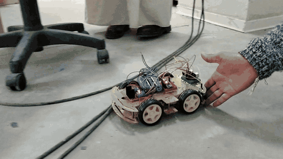
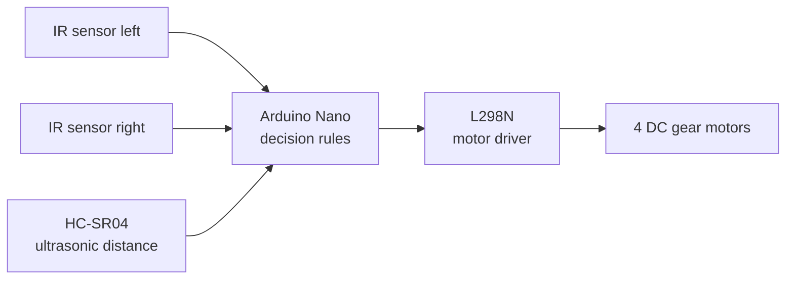
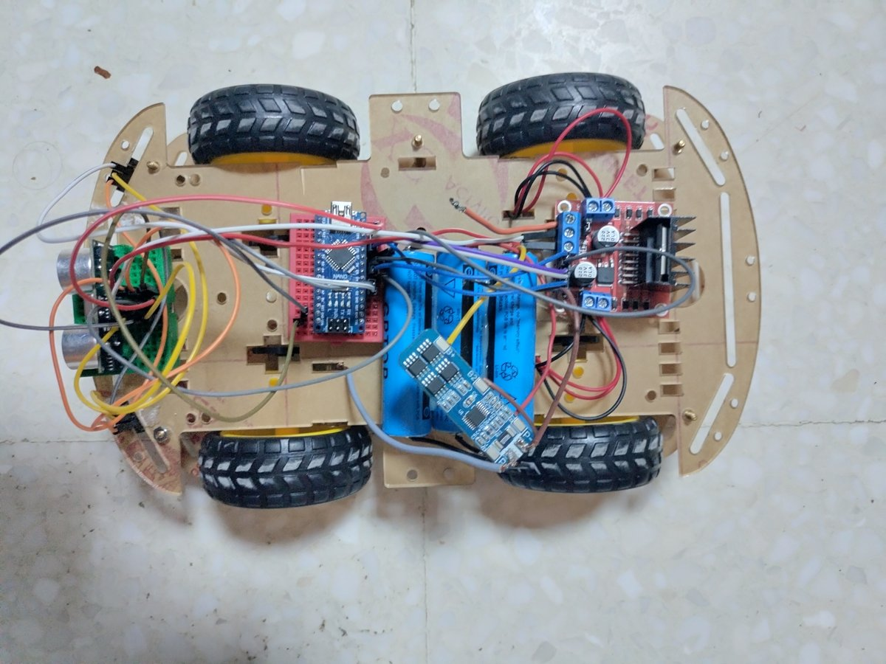
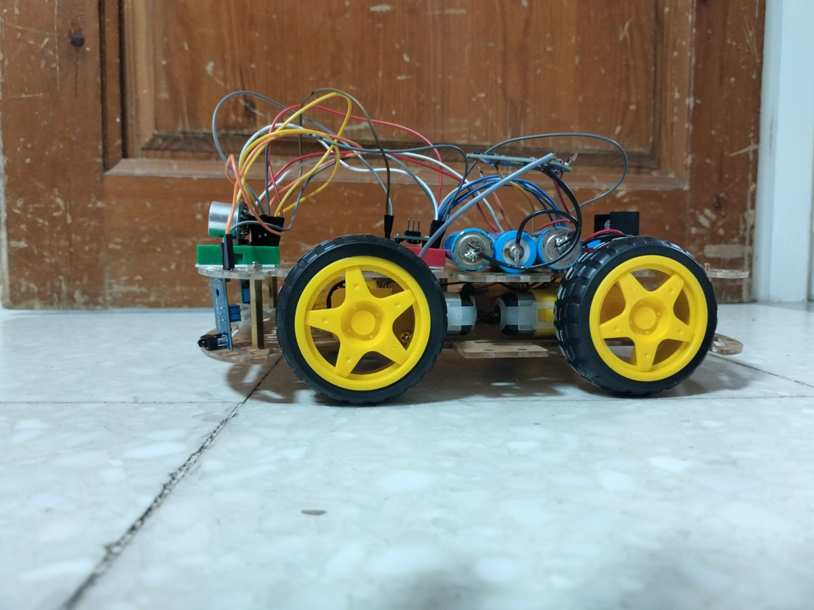
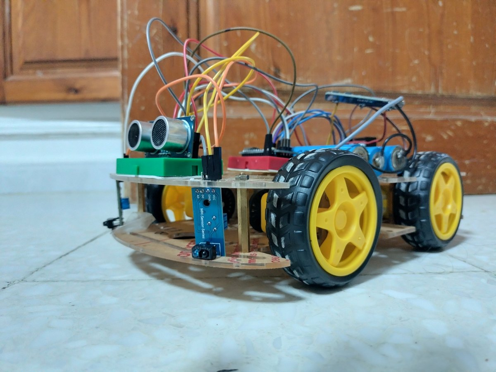

# Human-Following Robot

> A 4-wheel robot built on an **Arduino Nano** that follows a person: two infrared sensors steer it toward the person, and an ultrasonic sensor keeps it at a following distance.



Semester project at **ENISo, National Engineering School of Sousse** (January 2025).

---

## The problem

Carrying loads by hand is tiring and risky, especially for people with reduced mobility or workers who move objects all day. The goal was to build a low-cost robot that can **follow its user on its own**, as a first step toward a carrying assistant.

## How it works

| Situation | Sensors | Robot action |
|---|---|---|
| Person detected on the **right** | right IR = LOW, left IR = HIGH | Turns right (left wheels faster) |
| Person detected on the **left** | right IR = HIGH, left IR = LOW | Turns left (right wheels faster) |
| Person straight ahead, **10–30 cm** away | ultrasonic distance in range | Drives straight |
| Too close, too far, or no one detected | anything else | Stops |

The control loop is **rule-based**: it reads the 3 sensors, picks one of the 4 actions above, and sets the motor speeds with PWM through the L298N driver.



## Hardware

| Component | Role |
|---|---|
| Arduino Nano | Reads the sensors and controls the motors |
| 2 × IR obstacle sensors (MH-Sensor-Series) | Detect whether the person is on the left or the right |
| HC-SR04 ultrasonic sensor | Measures the distance to the person |
| L298N motor driver | Sets the direction and speed (PWM) of the motors |
| 4 × DC gear motors + wheels, acrylic 4WD chassis | Movement |
| 3 × 18650 Li-ion cells with a 3S BMS board | Power supply |

| Top view | Side view | Front view |
|---|---|---|
|  |  |  |

### Wiring (Arduino Nano pins)

| Pin | Connected to |
|---|---|
| D2 | Right IR sensor |
| D3 | Left IR sensor |
| D11 / D12 | HC-SR04 Trig / Echo |
| D5 (PWM), D7, D8 | Right motors: ENA, IN1, IN2 |
| D6 (PWM), D9, D10 | Left motors: ENB, IN3, IN4 |

## Run it

1. Install the [Arduino IDE](https://www.arduino.cc/en/software) and the **NewPing** library (*Sketch → Include Library → Manage Libraries → "NewPing"*).
2. Open `firmware/human_following/human_following.ino`.
3. Select **Arduino Nano** as the board, then upload.
4. Settings at the top of the file: `MIN_DISTANCE` / `MAX_DISTANCE` (following range in cm), `MAX_FORWARD_MOTOR_SPEED` and `MAX_MOTOR_TURN_SPEED_ADJUSTMENT` (PWM, 0–255).

## Limitations and next steps

- IR sensors only have a short range, so the robot follows best when the person (or a hand) is close.
- Straight driving uses a fixed speed; a **PID controller** on the distance would make following smoother.
- Next steps from the report: camera-based person detection, LiDAR, and better energy management.

## Repository structure

```
├── firmware/human_following/human_following.ino   # Arduino code
└── docs/
    ├── demo.gif          # Demo
    ├── photos/           # Robot photos
    └── report-FR.pdf     # Project report (French)
```

## Team & my contribution

Team: **El Aziza Mariem Lanouar**, Nawres Rebbag and Asma Meftah, supervised by Mrs. Nabiha Brahmi (ENISo).

**My part:** I built the robot end to end: component selection, assembly and wiring, the Arduino firmware, and testing and tuning.

*The control logic follows the classic Arduino hand-following approach found in open-source tutorials, adapted to our hardware.*
